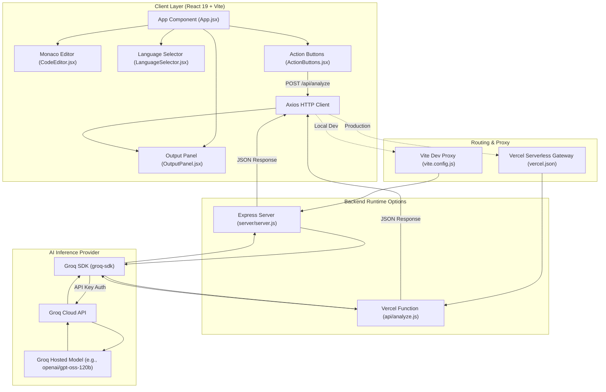

# AI Code Assistant

An AI-powered full-stack web application designed for interactive code inspection, explanation, bug detection, performance optimization, and complexity analysis. Built with React, Vite, Monaco Editor, Express, and Groq Cloud.

---

## Table of Contents

- [Overview & Features](#overview--features)
- [Architecture & Request Lifecycle](#architecture--request-lifecycle)
- [Architecture Diagram](#architecture-diagram)
- [Tech Stack](#tech-stack)
- [Repository Structure](#repository-structure)
- [Prerequisites](#prerequisites)
- [Local Setup Guide](#local-setup-guide)
- [Environment Variables](#environment-variables)
- [How to Use the App](#how-to-use-the-app)
- [API Reference](#api-reference)
- [Streaming & Concurrency Notes](#streaming--concurrency-notes)
- [Deployment (Vercel)](#deployment-vercel)
- [Limitations & Troubleshooting](#limitations--troubleshooting)

---

## Overview & Features

**AI Code Assistant** provides an in-browser development assistant where users can paste code snippets, select the language, and trigger targeted AI analysis workflows powered by Groq Cloud.

### Core Features

- **Embedded Monaco Editor**: Powered by `@monaco-editor/react` with the `vs-dark` theme, smooth scrolling, cursor animations, custom monospace typography (`JetBrains Mono`, `Fira Code`), and syntax highlighting.
- **Multi-Language Support**: Dedicated language selector with syntax modes for:
  - **JavaScript**
  - **C++**
  - **Python**
  - **Java**
- **4 AI Analysis Actions**:
  - 💡 **Explain**: Breaks down the provided code logic step-by-step into clear, plain English.
  - 🐛 **Find Bugs**: Identifies syntax issues, logical bugs, and edge cases, providing actionable bug fixes.
  - ⚡ **Optimize**: Analyzes execution efficiency and proposes cleaner, faster implementations.
  - 📊 **Complexity**: Details asymptotic Time and Space Complexity with Big-O notation.
- **Rich Markdown Rendering**: Formats AI responses using `react-markdown` to render headings, code fences, inline syntax, and tables cleanly.
- **Dual Runtime Support**:
  - **Local Development**: Node.js + Express backend with a configurable port and Vite reverse proxy.
  - **Serverless Production**: Ready for deployment on Vercel using standalone Serverless Functions in `/api`.
- **Static Analysis Only**: Operates strictly as a static code inspection and reasoning tool; the application **does not compile or execute arbitrary code**.

---

## Architecture & Request Lifecycle

```
[ User Browser / Monaco Editor ]
              │
              │ (1) User pastes code, selects language & action
              ▼
[ React Frontend (Vite) ]
              │
              │ (2) Axios POST /api/analyze { code, language, action }
              ▼
[ API Proxy / Serverless Gateway ]
       ├── (Local Dev) ──► Vite Proxy (localhost:5000 or BACKEND_PORT) ──► Express Server (server.js)
       └── (Vercel)    ──► Serverless Route (/api/(.*))                 ──► Serverless Function (api/analyze.js)
                                                                                  │
                                                                                  │ (3) Groq SDK Client (groq-sdk)
                                                                                  ▼
                                                                        [ Groq Cloud Inference ]
                                                                        (Model: openai/gpt-oss-120b)
                                                                                  │
                                                                                  │ (4) Returns AI completion
                                                                                  ▼
                                                                        [ Backend Response ]
                                                                        { "result": "..." }
                                                                                  │
                                                                                  │ (5) Axios receives JSON
                                                                                  ▼
                                                                        [ React State Update ]
                                                                        (OutputPanel renders Markdown)
```

### Detailed Lifecycle

1. **Input & Validation**: The user writes or pastes code into the Monaco Editor and clicks an action button. If the editor is empty, an alert prompts the user to provide code.
2. **State & UI Lock**: The frontend marks `loading = true`, disabling action buttons and rendering a progress badge (`🚀 AI is analyzing your code...`) to prevent duplicate submissions.
3. **Dispatch**: Axios sends an HTTP POST request to `/api/analyze` with the payload `{ code, language, action }`.
4. **Proxy & Routing**:
   - In local development, the Vite dev server proxies `/api` to the Express backend.
   - On Vercel, requests are routed via `vercel.json` rewrites directly to the serverless function `api/analyze.js`.
5. **Prompt Construction**: The backend matches the action to a specialized system/user prompt template:
   - `explain`: `"Explain this <language> code clearly:"`
   - `bugs`: `"Find bugs in this <language> code and provide the fix:"`
   - `optimize`: `"Optimize this <language> code for performance:"`
   - `complexity`: `"Analyze the time and space complexity of this <language> code:"`
6. **Inference**: The backend invokes `groq.chat.completions.create` using the configured Groq model (default: `openai/gpt-oss-120b`, or custom model via `GROQ_MODEL`).
7. **Delivery & Presentation**: The backend returns `{ result: "..." }`. The frontend sets the response in React state, unlocks the action buttons (`loading = false`), and `OutputPanel` renders the formatted markdown output.

---

## Architecture Diagram



---

## Tech Stack

### Frontend
- **React 19 (`react`, `react-dom`)**: Component-based UI library.
- **Vite 7**: Frontend build tool and local development server with API proxying.
- **@monaco-editor/react**: VS Code Monaco editor wrapper for syntax-highlighted in-browser editing.
- **react-markdown**: Markdown parser and renderer for AI generated responses.
- **Axios**: Promise-based HTTP client for API communication.

### Backend
- **Node.js**: Asynchronous JavaScript runtime (ES Modules).
- **Express 5**: Minimal web framework powering the local API server (`server/server.js`).
- **groq-sdk**: Official client library for Groq Cloud high-speed LLM inference.
- **dotenv**: Environment variable management.
- **cors**: Cross-Origin Resource Sharing middleware.

### Cloud & Infrastructure
- **Groq Cloud API**: High-throughput LPU inference platform.
  - **Default Model**: `openai/gpt-oss-120b` (configurable via `GROQ_MODEL`).
- **Vercel**: Serverless platform configured with `vercel.json` and `/api` serverless functions.

---

## Repository Structure

```
AI_CodeAssistant/
├── .env                      # Environment variables (GROQ_API_KEY, PORT, etc. - gitignored)
├── .gitignore                # Git ignore rules (node_modules, .env, dist, .venv, etc.)
├── index.html                # Vite HTML entry point
├── package.json              # Frontend dependencies and Vite build scripts
├── package-lock.json         # Pinned frontend dependency graph
├── vercel.json               # Vercel deployment configuration and API rewrites
├── vite.config.js            # Vite configuration with React plugin and API proxy
├── eslint.config.js          # ESLint configuration
├── README.md                 # Project documentation
│
├── api/                      # Vercel Serverless API Functions
│   ├── analyze.js            # POST /api/analyze serverless handler using Groq SDK
│   └── test.js               # GET /api/test health check handler
│
├── server/                   # Local Express Backend
│   ├── package.json          # Server dependencies (express, groq-sdk, cors, dotenv)
│   ├── package-lock.json     # Pinned server dependency graph
│   └── server.js             # Express application with /api/analyze and /api/test
│
├── public/                   # Static assets
│   └── vite.svg              # Vite branding logo
│
└── src/                      # React Frontend Source Code
    ├── App.jsx               # Top-level application layout and health check hook
    ├── main.jsx              # Application bootstrap and DOM mounting
    ├── index.css             # Glassmorphism dark-theme styling
    ├── components/
    │   ├── ActionButtons.jsx # Explain, Bugs, Optimize, Complexity triggers & loading state
    │   ├── CodeEditor.jsx    # Monaco Editor component configuration
    │   ├── LanguageSelector.jsx # Language dropdown (JavaScript, C++, Python, Java)
    │   └── OutputPanel.jsx   # Markdown output container with empty state
    └── services/             # Reserved directory for modular API abstractions
```

---

## Prerequisites

Ensure you have the following installed locally:
- **Node.js**: v18.0.0 or later (v20+ or v22+ recommended)
- **npm**: v9.0.0 or later
- **Groq API Key**: A valid API key obtained from [Groq Console](https://console.groq.com/).

> **Note on Python / Virtual Environments**: If you see a `.venv` directory, please note that this is a 100% JavaScript/Node.js project. No Python runtime or virtual environment is required to build or run the application.

---

## Local Setup Guide

### 1. Clone the Repository

```bash
git clone https://github.com/krish5S/AI_CodeAssistant.git
cd AI_CodeAssistant
```

*(If your files are located inside an inner directory, navigate into that directory).*

### 2. Configure Environment Variables

Create a `.env` file in the project root:

```bash
touch .env
```

Add your Groq API key:

```env
GROQ_API_KEY=gsk_your_groq_api_key_here
```

### 3. Install Dependencies

Install dependencies for both the frontend and backend:

```bash
# Install frontend dependencies
npm install

# Install server dependencies
cd server
npm install
cd ..
```

### 4. Start the Application

You will need two terminal windows:

#### Terminal 1: Backend Server

```bash
cd server

# Recommended on macOS to avoid port 5000 AirPlay collision:
PORT=5001 npm start

# Or with default port (5000):
npm start
```

#### Terminal 2: Frontend Client

```bash
# If your backend runs on port 5001:
BACKEND_PORT=5001 npm run dev

# Or with default port (5000):
npm run dev
```

### 5. Open the Application

Open your browser and navigate to:
```
http://localhost:5173
```

---

## Environment Variables

| Variable | Scope | Required | Default | Description |
| :--- | :--- | :---: | :--- | :--- |
| `GROQ_API_KEY` | Backend / Vercel | **Yes** | *None* | Authentication token for Groq Cloud inference API. |
| `PORT` | Local Express Server | No | `5000` | Port for the Express server. Use `5001` on macOS if port 5000 is occupied by AirPlay Receiver. |
| `BACKEND_PORT` | Frontend (Vite) | No | `5000` | Port targeted by Vite proxy (`/api` -> `http://localhost:<BACKEND_PORT>`). |
| `GROQ_MODEL` | Backend / Vercel | No | `openai/gpt-oss-120b` | Model identifier passed to Groq SDK (e.g., `openai/gpt-oss-120b` or `llama-3.3-70b-versatile`). |

---

## How to Use the App

1. **Select Language**: Use the top-left dropdown to choose the language matching your code (**JavaScript**, **C++**, **Python**, or **Java**).
2. **Enter Code**: Paste or type your code into the Monaco Editor.
3. **Choose Analysis Mode**:
   - Click **💡 Explain** to get a breakdown of the code's behavior.
   - Click **🐛 Find Bugs** to check for potential defects and see recommended fixes.
   - Click **⚡ Optimize** to get performance and refactoring recommendations.
   - Click **📊 Complexity** to receive asymptotic time/space Big-O evaluations.
4. **View Output**: The right panel displays the formatted Markdown analysis with code blocks and explanations.

---

## API Reference

### 1. Code Analysis

- **Endpoint**: `/api/analyze`
- **Method**: `POST`
- **Headers**: `Content-Type: application/json`

#### Request Body

```json
{
  "code": "function binarySearch(arr, target) { ... }",
  "language": "javascript",
  "action": "complexity"
}
```

| Field | Type | Required | Values |
| :--- | :--- | :---: | :--- |
| `code` | string | Yes | Non-empty code snippet to analyze. |
| `language` | string | Yes | `javascript`, `cpp`, `python`, `java` |
| `action` | string | Yes | `explain`, `bugs`, `optimize`, `complexity` |

#### Successful Response (`200 OK`)

```json
{
  "result": "### Complexity Analysis\n\n- **Time Complexity:** O(log n)\n- **Space Complexity:** O(1)\n\n..."
}
```

#### Error Responses

- **`400 Bad Request`**: `{ "error": "No code provided" }`
- **`405 Method Not Allowed`** (Vercel): `{ "error": "Method not allowed" }`
- **`500 Internal Server Error`**: `{ "error": "AI failed", "details": "..." }` or `{ "error": "GROQ_API_KEY is not configured" }`

---

### 2. Health Check

- **Endpoint**: `/api/test`
- **Method**: `GET`
- **Response (`200 OK`)**:
  ```json
  {
    "message": "Backend is running and connected!"
  }
  ```

---

## Streaming & Concurrency Notes

### Streaming Behavior
- **Current Implementation**: The codebase currently uses **non-streaming request/response cycles**.
  - In [`server/server.js`](server/server.js) and [`api/analyze.js`](api/analyze.js), the backend calls `await groq.chat.completions.create(...)` and waits for the full text completion before sending a single JSON response `{ result: "..." }`.
  - In [`src/components/ActionButtons.jsx`](src/components/ActionButtons.jsx), Axios waits for the full response and updates React state all at once.
- **Resume Alignment**: If token-by-token streaming is desired (e.g., rendering text progressively as it is generated), it can be enabled by setting `stream: true` in the Groq SDK call, piping server-sent events (SSE) or a chunked transfer response, and consuming the stream using `fetch()` and `ReadableStreamDefaultReader` on the frontend.

### Concurrency Handling
- **Server-Side**: The Node.js Express server and Vercel serverless functions handle incoming requests asynchronously using the non-blocking Node.js event loop.
- **Client-Side**: The UI employs a single active request lock per user session: when an action is triggered, `loading` is set to `true`, disabling all analysis buttons and showing a loading indicator until the request completes or errors out.

---

## Deployment (Vercel)

The repository includes a ready-to-use [`vercel.json`](vercel.json) configuration for zero-config deployment on Vercel:

```json
{
  "buildCommand": "npm run build",
  "outputDirectory": "dist",
  "framework": "vite",
  "rewrites": [
    { "source": "/api/(.*)", "destination": "/api/$1" }
  ]
}
```

### Steps to Deploy

1. **Push Code to GitHub**: Ensure your latest changes are pushed to GitHub.
2. **Import into Vercel**: Connect your GitHub repository in the Vercel dashboard.
3. **Configure Environment Variables**:
   - In Vercel Project Settings > **Environment Variables**, add:
     - `GROQ_API_KEY`: Your Groq API key (`gsk_...`).
     - (Optional) `GROQ_MODEL`: Your preferred model ID if not using default.
4. **Deploy**: Click **Deploy**. Vercel will build the Vite frontend into `dist/` and expose the serverless endpoints under `api/analyze.js` and `api/test.js`.

---

## Limitations & Troubleshooting

### 1. macOS Port 5000 Collision (`EADDRINUSE`)
- **Issue**: On macOS Monterey, Ventura, Sonoma, and Sequoia, Apple's **AirPlay Receiver** (`ControlCenter`) listens on port 5000 by default. Starting the Express backend on port 5000 will fail with `listen EADDRINUSE: address already in use :::5000`.
- **Solution**:
  - Run the backend on port 5001: `PORT=5001 npm start`
  - Run Vite with matching proxy port: `BACKEND_PORT=5001 npm run dev`
  - *Alternatively*, disable AirPlay Receiver in **System Settings > General > AirDrop & AirPlay > AirPlay Receiver**.

### 2. Groq Model Availability (404 Error)
- **Issue**: Specifying a decommissioned or inaccessible model ID causes Groq to return `404: The model does not exist or you do not have access to it`.
- **Solution**: The backend defaults to `openai/gpt-oss-120b`. You can override this at any time by setting the `GROQ_MODEL` environment variable (e.g. in `.env` or your shell):
  ```bash
  GROQ_MODEL=openai/gpt-oss-120b
  ```

### 3. Missing `GROQ_API_KEY`
- **Issue**: Backend reports `GROQ_API_KEY is missing from your .env file!` or returns `500 GROQ_API_KEY is not configured`.
- **Solution**: Verify that a `.env` file exists in the project root containing `GROQ_API_KEY=gsk_...`. For Vercel deployments, ensure the environment variable is configured in the Vercel Project Settings.

### 4. Code Execution Disclaimer
- This project is an **AI code analysis and inspection assistant**. It does not execute, evaluate, or compile user-submitted code in a runtime sandbox.

---

## License

This project is open-source and available under the standard MIT License (see `package.json`).
